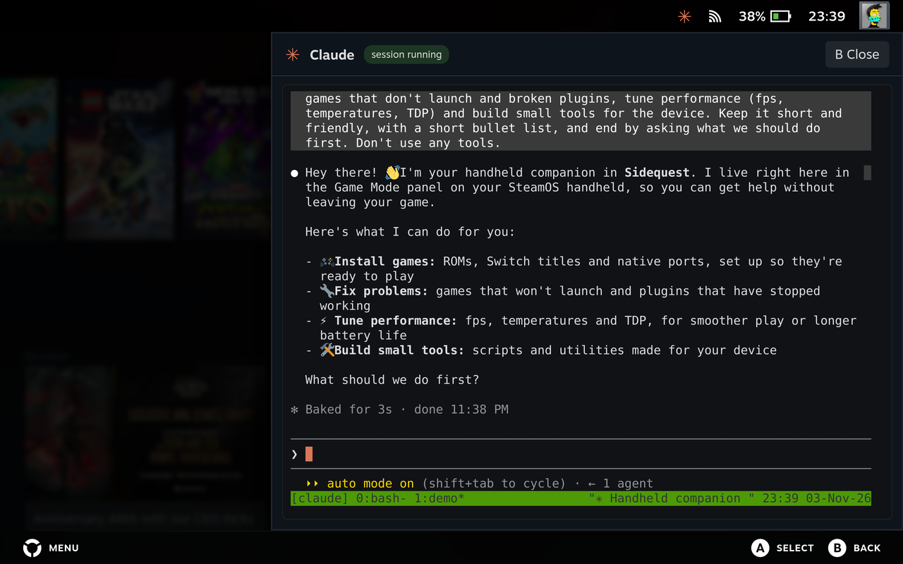
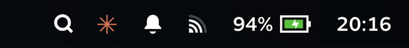

# Sidequest for Claude Code

**Claude Code on SteamOS handhelds, in Game Mode.** One persistent Claude Code session that you open as a side
panel from the Steam status bar, drive with the controller and the touchscreen, and also reach from Desktop Mode
and your phone.

> **Alpha.** Built and tested on a Lenovo Legion Go with SteamOS 3.9.5 and Decky Loader 3.3.0. It should work on
> other SteamOS devices (Steam Deck, Legion Go S, ROG Ally on SteamOS) but hasn't been tested there yet.
> [Device reports](../../issues/new?template=device_report.md) welcome.
>
> Sidequest is a community project. It is **not affiliated with or endorsed by Anthropic** or Valve.
> "Claude" and "Claude Code" are trademarks of Anthropic.

## What you get

- **Game Mode panel**: a ✳ icon in Steam's status bar opens your Claude session as a right-side panel (a Decky
  Loader plugin). B closes it; Claude keeps working.
- **Controller-first input**: Y opens Steam's keyboard straight into Claude's prompt, the D-pad navigates Claude's
  menus, touch-drag scrolls. Full mapping below.
- **Start / new conversation / stop** from the Quick Access menu (… button > Sidequest).
- **Login from Game Mode**: Claude's sign-in page opens in Steam's built-in browser; no Desktop Mode needed.
- **One session everywhere**: the same conversation in Game Mode, in a Desktop Mode terminal (`claude-session`),
  and, optionally, on your phone or claude.ai via Claude Code Remote Control.
- **Notifications**: a Steam toast when Claude needs your permission or input (desktop notification in Desktop Mode).
- **Voice (optional, recommended)**: answers read aloud, offline, with Piper ([docs/voice.md](docs/voice.md)).
- **About page**: the cog in the plugin's title bar (Quick Access > Sidequest) shows the version, the controls and
  the credits.

## Screenshots

The Claude panel in Game Mode, opened from the ✳ icon in Steam's status bar:





The Quick Access entry:


The ⚙ cog opens the About page:

| About | Controls | Credits |
|---|---|---|
|  |  |  |

## The companion agent

Sidequest isn't only a terminal: the Claude session it runs is set up as a **companion for your handheld**.

- **Roles:** install games (Steam, emulated, native ports), debug launches and controllers, profile and benchmark,
  optimize settings and power for your exact device, check everything after SteamOS updates.
- **Notebook:** it keeps `notes/` in the session folder: a hardware profile it discovers itself, a changelog of every
  change it makes (with how to undo it), what's in progress, and one page per game. New sessions read it first.
- **Skills:** step-by-step workflows in `skills/` (game install, Steam artwork, performance, power and thermals,
  controllers, Decky plugins...), linked into the session's `.claude/skills/`.
- **Knows your device:** the [shared knowledge](#shared-knowledge-knowledge) folder holds what only applies to some
  handhelds, operating systems and emulation suites. The hardware profile picks the folders that match yours.
- **Grows with its users:** when a session solves something other owners of that device will hit, the agent offers
  to turn it into a pull request from your own GitHub account, after you've seen the change.
- **Stays current:** at session start it checks for a new Sidequest release (once a day) and asks before updating.

Your own instructions for it go in `CLAUDE.local.md` in the session folder. The agent's rules are in
[agent/AGENT.md](agent/AGENT.md).

## Shared knowledge (`knowledge/`)

Everything Sidequest knows about specific setups lives in **[`knowledge/`](knowledge/)**, separate from the code:

| Folder | What's in it | Today |
|---|---|---|
| [`knowledge/devices/`](knowledge/devices/) | Per handheld: how to recognise it, display modes, controllers, power and fan controls, quirks, known-good settings, and device-specific scripts and services | Lenovo Legion Go (with the `profile-on-ac` fan/power service), common notes for any handheld |
| [`knowledge/os/`](knowledge/os/) | Per OS: what survives updates, how to install things safely, where logs are | SteamOS, Bazzite |
| [`knowledge/stacks/`](knowledge/stacks/) | Per emulation suite or frontend: paths, launchers, emulator quirks | EmuDeck |

The agent reads the folders that match your machine before it gives device-specific advice, so a fix found once on
one Legion Go helps every Legion Go owner.

**Your handheld isn't covered, or you found something better?** That's the most valuable contribution you can make,
and you don't have to write it yourself. When your agent solves a problem other owners would hit, it offers to share
it; or just ask it:

> Contribute what we learned about this device to Sidequest.

It writes the change into the right folder, strips personal data (user names, serials, IPs, your game library),
shows you the result and, only after your yes, opens a pull request from **your** GitHub account. New devices,
other OSes (ChimeraOS, Bazzite...), other stacks (RetroDECK, ES-DE setups...) and tuned per-game settings are all
welcome. Details: [knowledge/README.md](knowledge/README.md) and [CONTRIBUTING.md](CONTRIBUTING.md).

## Skills

Skills are step-by-step workflows the agent follows for a kind of task (in `skills/`, linked into the session's
`.claude/skills/`). You don't call them by name: ask for what you want and the agent picks the right one (or type
`/<skill>` to force it).

| Skill | What it does | Ask it, for example |
|---|---|---|
| [`game-install`](skills/game-install/SKILL.md) | Installs a game you supply (ROM, disc image, Switch NSP/XCI, PC game, native-port dump) so it works from Game Mode: right folder, metadata, Steam shortcut, artwork, controllers. Optional unattended inbox: drop a file in a folder and it gets installed. | “Install the Zelda NSP I put in Downloads” |
| [`rom-library`](skills/rom-library/SKILL.md) | Organizes an emulation library: one folder per system, No-Intro/Redump naming, one file per game, BIOS placement, duplicates, and scraped metadata and artwork for the frontend. | “Clean up my SNES folder and scrape the artwork” |
| [`native-ports`](skills/native-ports/SKILL.md) | Finds, compares, installs and updates native PC ports of console games: decompilations, static recompilations and port runtimes (Ship of Harkinian, Zelda64Recomp...). | “Is there a native port of Mario 64? Install the best one” |
| [`steam-library`](skills/steam-library/SKILL.md) | Manages non-Steam shortcuts live through Steam's client API: add shortcuts, collections, launch options, full artwork from SteamGridDB, checked visually. | “Put all my Switch games in a collection with artwork” |
| [`launch-debugging`](skills/launch-debugging/SKILL.md) | Diagnoses games that don't start, crash or hang: Proton versions, logs, anti-cheat, launchers, prefixes, shader cache. | “This game closes right after the logo” |
| [`performance`](skills/performance/SKILL.md) | Measures fps, frame pacing, CPU/GPU load and clocks, temperatures and power; finds the bottleneck; tunes the frame cap, power and in-game settings. | “Find the best settings for this game at 60 fps” |
| [`power-thermals`](skills/power-thermals/SKILL.md) | TDP and performance profiles, CPU boost, GPU clocks, fan behaviour, charger-dependent profiles, battery care. | “Use more power when I'm on the charger” |
| [`controllers`](skills/controllers/SKILL.md) | Fixes controllers that aren't detected, wrong or stuck buttons, wrong player order in emulators, Steam mappings for unknown pads. | “Player 2 is wrong in Dolphin” |
| [`decky-plugins`](skills/decky-plugins/SKILL.md) | Installs, updates, troubleshoots and removes Decky Loader and its plugins, from the store or established community repos. | “Decky disappeared after the update” |
| [`hardware-profile`](skills/hardware-profile/SKILL.md) | Discovers this handheld's hardware and software (model, CPU/GPU, display, storage, controllers, power and fan interfaces, OS, emulation stack), matches the device/OS/stack knowledge folders and writes the notebook's hardware page. | Runs on its own in the first session |
| [`post-update-check`](skills/post-update-check/SKILL.md) | After a SteamOS, Steam, BIOS or Decky update, checks everything Sidequest and your setup rely on, fixes what broke and logs it. | “I just updated SteamOS” |
| [`screen-control`](skills/screen-control/SKILL.md) | Sees and controls the Desktop Mode screen (screenshots, mouse and keyboard) for tasks with no command-line route. Always asks first. | “Click through this installer for me” |
| [`contribute`](skills/contribute/SKILL.md) | Turns something that solved a real problem (a device quirk, tuned settings, a script, a new device folder) into a pull request from your own GitHub account, with personal data removed and your approval. | “Share this fix with other Legion Go owners” |
| [`save-sync`](skills/save-sync/SKILL.md) | Backs up and syncs your emulator saves with [Extra Life](https://github.com/gcysne/extra-life): installs it from its official release, connects Google Drive, Dropbox, OneDrive, an SD card or a NAS, runs the first sync, restores older versions and settles conflicts. (Saves only: ROMs and BIOS are never uploaded.) | “Back up my saves to Google Drive” |
| [`sidequest-update`](skills/sidequest-update/SKILL.md) | Updates Sidequest itself (agent, skills, device knowledge, plugin) to a newer release, after you agree. | “Update Sidequest” |

New skills are welcome: see [CONTRIBUTING.md](CONTRIBUTING.md).

## Requirements

- SteamOS 3.7+ (or another Linux with Steam's Game Mode / gamescope session and systemd).
- [Decky Loader](https://decky.xyz) for the Game Mode panel.
- A Claude subscription (Pro, Max, Team, Enterprise) or an Anthropic Console account. Claude Code's
  [usage terms](https://www.anthropic.com/legal) apply.
- Installed for you if missing: [Claude Code](https://docs.claude.com/en/docs/claude-code/setup) (official
  installer) and, only to build the plugin, Node.js (official build from nodejs.org, checksum-verified, kept in
  `~/.cache/sidequest/node`). `tmux`, `python3` and `curl` ship with SteamOS.

## Install

In **Desktop Mode**, open Konsole and run:

```bash
curl -fsSL https://raw.githubusercontent.com/gcysne/sidequest/main/get.sh | bash
```

It clones Sidequest into `~/sidequest` and runs its installer. Prefer to read before running? Same thing by hand:

```bash
git clone https://github.com/gcysne/sidequest.git ~/sidequest
cd ~/sidequest
./install.sh
```

**Or let Claude do it.** If you already use Claude Code (or Claude with access to a terminal on the device), give it
this prompt:

> Install this for me: https://github.com/gcysne/sidequest

> **Note for AI agents installing Sidequest:** read this README first. Run it in Desktop Mode: clone the repository
> into `~/sidequest` and run `./install.sh` there (it asks the user about text-to-speech; pass `--voice` or
> `--no-voice` once the user has answered). The only root step is copying the Decky plugin into `~/homebrew/plugins`:
> explain it and let the user enter the password (`sudo -A` with a graphical askpass, e.g. `SUDO_ASKPASS=/usr/bin/ksshaskpass`).
> Decky Loader must be installed first (decky.xyz). Afterwards, point the user to [First run](docs/first-run.md).

The installer explains each step. It **offers text-to-speech** (recommended, see [voice](docs/voice.md)); the choice
is yours. It asks for your password once, to copy the plugin into Decky's folder (`~/homebrew/plugins` belongs to
root). Everything else stays in your home folder. Re-run it to update
(`cd ~/sidequest && git pull && ./install.sh`, or the one-liner again).

Then switch to Game Mode and follow **[First run](docs/first-run.md)**: start Claude from the Quick Access menu,
pick a theme, and sign in. It takes about two minutes.

Options: `--voice` / `--no-voice` (answer the voice question up front), `--no-plugin`, `--no-claude`. Remove with `./uninstall.sh`.

## Using it

> **Full guide with every button, gesture and setting: [docs/usage.md](docs/usage.md).**

**Open** the panel with the **✳ icon** in Steam's status bar, or <kbd>…</kbd> Quick Access menu > **Sidequest**.
**Close** it with <kbd>B</kbd>: Claude keeps working and sends a Steam toast when it needs you.

| Button | In the panel |
|---|---|
| <kbd>A</kbd> | **Enter**: send, confirm a choice |
| <kbd>B</kbd> | **Close the panel** (Claude keeps running) |
| <kbd>X</kbd> | **Shift+Tab**: switch Claude's mode |
| <kbd>Y</kbd> | **Steam keyboard**, typing straight into Claude's prompt |
| <kbd>D-pad</kbd> / left stick | **Arrow keys**: menus, prompts, message history, cursor |
| <kbd>LT</kbd> | **Esc**: interrupt Claude; twice on an empty prompt = rewind |
| <kbd>RT</kbd> hold | **Space, held**: push-to-talk in `/voice` hold mode |
| <kbd>LB</kbd> / <kbd>RB</kbd> | **Page Up / Page Down** |
| <kbd>☰</kbd> Menu | **`/`**: start a slash command |
| <kbd>⧉</kbd> View | **Tab**: autocomplete |
| Touchscreen | **drag** to scroll, **tap** to click |

**Quick Access menu > Sidequest:** **Start Claude** (continue) · **Start a new conversation** ·
**New conversation** · **Stop session** · **Open Claude panel**.

**Desktop Mode:** run `claude-session` in a terminal to join the same session (not plain `claude`, which would start
a separate one). `claude-session --help` lists the other commands.

### Settings

`~/.config/sidequest/config`:

| Setting | Default | |
|---|---|---|
| `PANEL_WIDTH` | `70` | Panel width, % of the screen (30–100). Next panel open. |
| `PANEL_FONT_SIZE` | `15` | Terminal font size, px (8–40). Next panel open. |
| `PROJECT_DIR` | `"$HOME/Claude"` | Folder Claude works in. After Stop + Start. |
| `REMOTE_CONTROL_NAME` | `""` (off) | Claude Code Remote Control name. After Stop + Start. |

## How it works

```
 Game Mode (Steam UI)                         your home folder
 ┌────────────────────────────┐   pty bridge  ┌──────────────────────────────────────────┐
 │ Decky plugin "Sidequest" │◄────────────► │ tmux -L claude  (claude-session.service)  │
 │  status-bar icon, panel,   │               │   └─ claude (Claude Code) in PROJECT_DIR │
 │  xterm.js terminal         │◄── spool ──── │ claude-open-url / claude-notify (hooks)  │
 └────────────────────────────┘               └──────────────────────────────────────────┘
        Desktop Mode terminal ── claude-session ──► same tmux session
```

- The session runs in tmux under a systemd **user** service with linger, so it survives switching between Desktop
  and Game Mode.
- The panel attaches a new tmux client inside a pseudo-terminal in the plugin's Python backend and streams it to
  xterm.js. Closing the panel only detaches.
- Claude's browser requests (`BROWSER=claude-open-url`) and notification hooks drop small files in
  `~/.local/state/sidequest/`. The plugin turns them into Steam's browser and Steam toasts.

| Installed piece | Where |
|---|---|
| Scripts (`claude-session`, `claude-open-url`, `claude-notify`, `claude-tts`) | `~/.local/lib/sidequest`, linked in `~/.local/bin` |
| Session service | `~/.config/systemd/user/claude-session.service` |
| Settings | `~/.config/sidequest/` |
| Companion agent | `<project folder>/CLAUDE.md` (imports the agent), `.claude/skills/`, `notes/` (your notebook) |
| Knowledge base (agent, skills, devices, os, stacks) | `~/.local/lib/sidequest/` |
| Claude Code hooks (notifications, voice) | `<project folder>/.claude/settings.json` (merged; your hooks are kept) |
| Decky plugin | `~/homebrew/plugins/sidequest` |
| Logs | `~/.local/state/sidequest/*.log`, Decky: `journalctl -u plugin_loader` |

## Optional extras

- **Voice** (recommended; the installer offers it): Claude reads the start of each answer aloud, offline with Piper.
  `./install.sh --voice` adds it later. Using it, other voices, removing it: **[docs/voice.md](docs/voice.md)**.

## Known limitations (alpha)

- Device back buttons (e.g. Legion Go Y1–Y3/M3) don't reach Steam's UI, so the panel can't use them.
- The left stick can't be told apart from the D-pad in Steam's UI; both send arrows.
- Touch scrolling moves in steps (one wheel event per text row).
- Google sign-in may refuse Steam's built-in browser; use email sign-in, or sign in once in Desktop Mode.
- The status-bar icon hooks into Steam's UI internals; a Steam client update can break it. The Quick Access menu
  entry keeps working when that happens.
- Running a game while the panel is open isn't handled yet.

## Development

`decky-plugin/` is a standard Decky plugin (TypeScript + rollup, Python backend). `corepack pnpm install`,
`corepack pnpm run build`, then `decky-plugin/install.sh`. Design notes: `docs/spikes/`, `docs/panel-backlog.md`.
CI (`.github/workflows/build.yml`) lints the scripts, builds the plugin and attaches `sidequest.zip` to tagged releases.
See [CONTRIBUTING.md](CONTRIBUTING.md) and [SECURITY.md](SECURITY.md).

**Found a bug?** Open an issue, then ask Claude to fix it, validate it and open a pull request too: see
[CONTRIBUTING.md](CONTRIBUTING.md).

## Credits

Created by **Gabriel Cysne** ([@gcysne](https://github.com/gcysne)), who had the idea, leads the project and tests every build.
The code is written by Claude (Anthropic's Claude Code), working with Gabriel Cysne. Licensed under the [MIT License](LICENSE);
bundled third-party code: [THIRD_PARTY_NOTICES](THIRD_PARTY_NOTICES).

## License

See [LICENSE](LICENSE).
